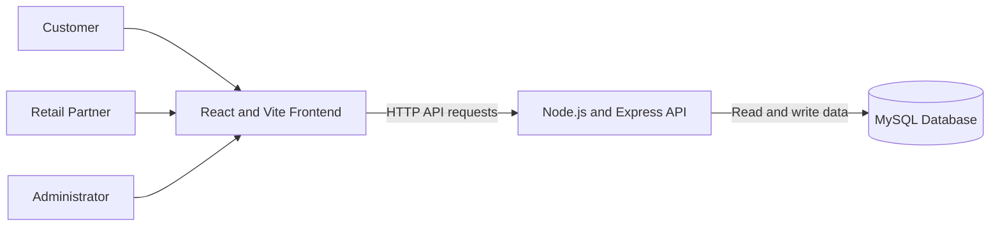
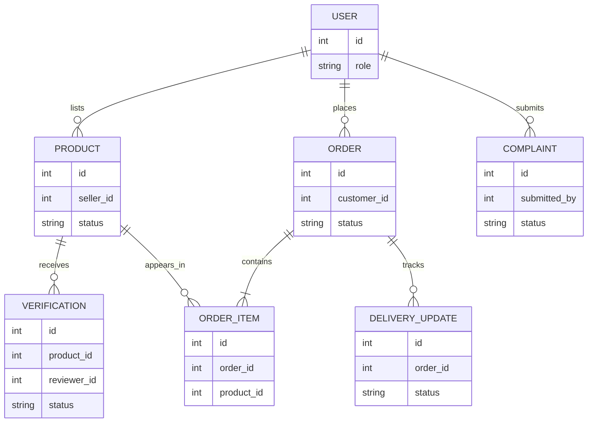

# System Architecture

This document describes the platform at a high level. The diagrams use Mermaid.js.

## System context

## Core domain relationships

The following is a conceptual ERD of the platform's principal records. It is not a migration specification; confirm fields and relationships against the current database schema before implementation.

## Main request flow

1. A customer, retail partner, or administrator uses the React frontend.
2. The frontend sends requests to the Node.js and Express API.
3. The API applies authentication, authorization, validation, and business rules.
4. The API reads or writes platform data in MySQL and returns a response to the frontend.
